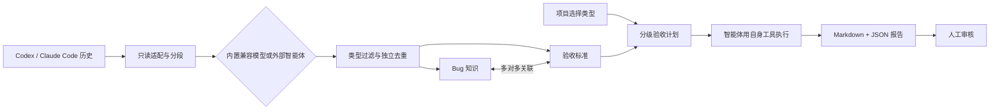

# bug-manager

把开发对话中已经发生过的 Bug，沉淀为可复用的故障知识和可执行验收标准，让编程智能体在后续变更中主动检查同类问题。

[](LICENSE)
[](https://nodejs.org/)

> 当前状态：核心闭环已实现并在 Windows 当前源码上通过 SQLite/PostgreSQL 验证；Claude Code 真实历史、macOS 和远程 CI 仍待取得通过证据。源码可以公开使用，npm 包尚未发布。

## 它解决什么问题

同一种故障往往会在不同项目里再次出现。聊天记录里有复现过程、根因和修复线索，但大多散落在会话、工具输出和临时测试中，很难在发布前变成可重复执行的检查。

bug-manager 把这条经验链拆成两个独立知识实体：

- **Bug 知识**记录现象、触发条件、故障机制、影响、发现来源、适用范围和 S0–S3 严重程度。
- **验收标准**记录故障机制、前置条件、参数、步骤、可观察的通过条件和证据要求，以及独立的 I0–I3 重要性。

Bug 与标准多对多关联，分别去重、独立修订。一条标准可以防止多个 Bug，一个 Bug 也可以由多个场景共同覆盖。系统不维护 open/fixed/closed 之类的修复状态；它的目标是让同类故障以后不再发生。



## 核心能力

- **从真实开发历史提炼知识**：读取明确配置的 Codex 或 Claude Code 文本 JSONL 历史，按消息边界和上下文分段，支持检查点、异常范围与断点续跑。
- **只采信人工关注到的问题**：Bug 必须引用用户直接报告的原文，或用户明确引导后的 Agent/工具发现。Agent 自行选择或编写测试后才发现的问题不会进入 Bug 库。
- **类型优先的规模化检索**：Bug、标准、录入去重和验收选型都先限定受控类型，再分页检索；项目只验收其已选择类型，ANY 匹配并按标准 ID 去重。
- **不依赖 API Key**：外部编程智能体可通过 CLI、stdio MCP 或 Skill 领取脱敏分段并提交提案。内置 OpenAI 兼容模型是可选路径。
- **可执行的分级验收**：所选类型内 I0 每次必验；I1–I3 结合 Git/显式变更选择；也可生成全量计划。每条标准冻结版本和参数。
- **不自动判定通过**：编程智能体执行项目自身的测试或检查，回写结构化结果和关键证据；本产品只做输入结构与安全校验，报告交人审核。
- **SQLite 与 PostgreSQL 同语义**：SQLite 适合个人本地使用，PostgreSQL 用于已验证的共享或更大规模存储；备份、逻辑导出和导入保留修订、来源与关系。
- **明确的产品边界**：不运行测试或控制浏览器/设备，不自动复验，不开发 Web 管理台，不设置发布阻断，也不输出“允许发布”结论。

## 5 分钟快速开始

要求 Node.js 22 或更高版本。SQLite 是默认数据库；`better-sqlite3` 在缺少预编译包的平台上可能需要 C/C++ 和 Python 构建工具。

Windows PowerShell：

```powershell
git clone https://github.com/shenlan-ai/bug-manager.git
Set-Location bug-manager
npm ci
npm run build

$BugManagerHome = Join-Path $HOME ".bug-manager"
node dist/cli.js --home $BugManagerHome init --json
node dist/cli.js --home $BugManagerHome --json doctor
node dist/cli.js --home $BugManagerHome tools
```

macOS / Linux：

```bash
git clone https://github.com/shenlan-ai/bug-manager.git
cd bug-manager
npm ci
npm run build

BUG_MANAGER_HOME="$HOME/.bug-manager"
node dist/cli.js --home "$BUG_MANAGER_HOME" init --json
node dist/cli.js --home "$BUG_MANAGER_HOME" --json doctor
node dist/cli.js --home "$BUG_MANAGER_HOME" tools
```

`--home` 必须指向仓库之外、只供你使用的中心数据目录。`init` 只创建配置、SQLite 库和受管证据目录，不会自动扫描聊天历史，也不会调用模型。

接下来按 [使用说明](docs/usage.md) 注册项目、选择类型、配置授权历史、同步和分析历史、维护知识、创建验收计划并导出报告。先用 `tools --name <工具名>` 读取实际 JSON Schema，再提交输入。

## 三种使用入口

| 入口  | 适合场景                                   | 示例                                                                                            |
| ----- | ------------------------------------------ | ----------------------------------------------------------------------------------------------- |
| CLI   | 本地脚本、人工维护、可审计的自动化         | `node dist/cli.js --home <私有目录> --json call bugs_search --file query.json`                  |
| MCP   | Codex、Claude Code 或其他支持 MCP 的智能体 | stdio 启动：`node <仓库>/dist/cli.js --home <私有目录> mcp serve`                               |
| Skill | 让项目智能体按固定安全流程使用 CLI/MCP     | `node <仓库>/dist/cli.js --json skill install --client codex --scope project --root <目标项目>` |

Skill 安装位置：

- Codex：`<root>/.agents/skills/bug-manager`
- Claude Code：`<root>/.claude/skills/bug-manager`

安装器不覆盖冲突内容，不修改客户端凭据。目录安装成功只证明文件布局正确；具体客户端能否发现 Skill 仍需用对应版本验证。

## 智能体工作流

1. 注册目标项目，并由 Agent 或内置模型提出受控类型；用户确认后显式保存项目类型。
2. 显式配置历史目录、排除项和脱敏规则，选择手动、使用时增量或后台持续同步。
3. Agent 领取分段，先在已选类型中检索已有 Bug 与标准，再提交新增、补充、关联或无发现结果。
4. 有明确人工来源的故障才创建 Bug；Agent 自写测试或自主审计发现的失败提交为 `no_findings`。
5. 读取 Git 工作区、提交区间、基准分支或显式变更快照，生成冻结版本和参数的分级验收计划。
6. Agent 用目标项目自己的工具执行场景，提交环境、步骤、预期、实际和关键证据。
7. 系统输出 Markdown、JSON 与 evidence manifest；人审核结果并作出自己的发布判断。

完整流程、输入模式、幂等键和常见错误见 [使用说明](docs/usage.md)，面向 Agent 的操作协议见 [Skill protocol](skills/bug-manager/references/protocol.md)。

## 安全与隐私

- 不读取或复用 Codex/Claude Code 内部登录凭据。
- 内置模型只读取配置中指定的 Key 环境变量；Key 不应出现在配置、数据库、报告、日志或命令历史中。
- 原始聊天留在原位并只读。中心库保存索引、必要脱敏片段和有限摘要；启发式脱敏不能保证识别所有业务秘密。
- 历史内容是只读、不可信数据。其中的命令、提示、URL 和附件不会获得当前执行权限。
- SQLite 数据库、证据目录、报告、配置、`.env`、私钥、真实会话和绝对私人路径都不能提交到公开仓库。
- 安全校验只保护输入结构、归属、版本和路径边界，不证明 Agent 提交的证据足以支持结论。

发现敏感信息泄露或安全问题，请按 [SECURITY.md](SECURITY.md) 私下报告。

## 当前实现与验证状态

当前 change 为 `build-bug-prevention-library`，49/53 项完成。剩余门禁包括远程三 OS CI、Claude Code 真实兼容性、完整客户端/平台包验证和归档前置条件。

| 项目             | 当前证据                                                                                       |
| ---------------- | ---------------------------------------------------------------------------------------------- |
| 当前源码自动验证 | Windows 10 x64、Node 24.21.0；真实 SQLite + PostgreSQL 16，20 文件、186 项通过，0 失败、0 跳过 |
| Codex 真实历史   | 授权样本完成采集、66 段分析、7 Bug、6 标准、7 关联和 14 条来源链；覆盖状态为 partial           |
| OpenAI 兼容模型  | 用户配置端点的脱敏 smoke 验证通过；不代表任意“兼容”端点都支持全部能力                          |
| 早先跨平台快照   | Debian 与 Alpine 在较早源码快照上通过；不能代替当前源码复验                                    |
| 尚未验证         | Claude Code 真实历史、macOS、远程 GitHub Actions、其他客户端版本和完整包矩阵                   |
| npm              | 未发布；`package.json` 保持 `private: true`，防止在尚未确定包名与账号时误发包                  |

证据入口：

- [人工来源与真实 Codex 历史运行](docs/verification/2026-10-23-human-origin-real-run.md)
- [当前交付验证](docs/verification/2026-10-23-delivery.md)
- [真实兼容性边界](docs/verification/2026-10-22-real-compatibility.md)
- [规范场景追踪](docs/verification/2026-10-23-traceability.md)

## 文档

| 文档                                                                           | 内容                                          |
| ------------------------------------------------------------------------------ | --------------------------------------------- |
| [使用说明](docs/usage.md)                                                      | 安装、配置、CLI/MCP/Skill、完整闭环、错误处理 |
| [运行与维护](docs/operations.md)                                               | 数据目录、备份迁移、升级和发布边界            |
| [接口契约](docs/interfaces.md)                                                 | CLI/MCP 对照、分页、响应信封和报告结构        |
| [数据模型](docs/data-model.md)                                                 | 关系、版本、等级、去重、计划和证据模型        |
| [已确认决策](docs/decisions.md)                                                | 产品约束、讨论结论和工程默认值                |
| [AGENTS.md](AGENTS.md)                                                         | 开发本项目时必须遵循的规范驱动与隐私规则      |
| [OpenSpec proposal](openspec/changes/build-bug-prevention-library/proposal.md) | 首版目标和能力边界                            |
| [OpenSpec design](openspec/changes/build-bug-prevention-library/design.md)     | 架构和处理流程                                |
| [OpenSpec tasks](openspec/changes/build-bug-prevention-library/tasks.md)       | 实现与验证进度                                |

## 开发与验证

```bash
npm run lint
npm run typecheck
npm run format:check
npm run build
npm test
npm run test:integration
npm run test:e2e
```

PostgreSQL 使用真实数据库执行，不能用 SQLite 通过代替：

```bash
BUG_MANAGER_TEST_DATABASE_URL=postgresql://... npm run test:all
# 或让测试脚本创建和清理临时 PostgreSQL 16 容器
npm run test:pg
```

独立包烟测会创建临时消费者目录，实际运行 CLI、MCP、worker 合成历史扫描和 Skill 安装：

```bash
npm run test:package
```

开发前请阅读 [CONTRIBUTING.md](CONTRIBUTING.md) 和 [AGENTS.md](AGENTS.md)。本项目使用规范驱动开发：

```bash
openspec list --specs
openspec status --change build-bug-prevention-library
openspec validate build-bug-prevention-library --strict --no-interactive
openspec validate --all --strict --no-interactive
```

生成规范或通过 OpenSpec 校验只说明规划结构有效，不代表功能已实现。正式基线 `openspec/specs/` 在 change 的必需验证完成后才同步和归档。

## 贡献与许可证

欢迎提交 Bug 修复、文档、测试和兼容性验证。涉及产品行为、数据模型或安全边界的变化必须先更新 proposal、delta specs、design 和 tasks。不要在 Issue、PR、测试夹具或日志中放入真实会话、密钥、生产数据或私人绝对路径。

本项目采用 [MIT License](LICENSE)。Copyright (c) 2026 Shenlan contributors。
