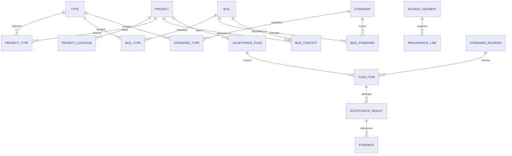

# 数据模型与不变量

本文描述目标模型，实现与验证进度见 tasks 和验证记录。库内实体 ID 使用稳定 UUID，外部会话/消息标识按来源保留，指纹和内容哈希另存；时间以 UTC 存储并保留需要的原始时区信息。JSON 导出含 schema_version，知识实体与历史修订不可用同一行覆盖代替。

## 关系

## 核心关系表

| 表组 | 主要字段与职责 |
| --- | --- |
| projects / project_locations | stable id、name、配置版本；多个规范化工作目录、可选仓库标识/别名。路径与 remote 不是唯一项目身份 |
| types / type_aliases / tags | 稳定类型 ID、名称、定义、可选父级、别名；新类型建议与词典改名留痕；标签另存，不混入类型选择 |
| project_type_selections | project_id、type_id、selection_revision、reason、actor、selected_at；配置版本不可被后台默默替换 |
| bugs / bug_revisions | 当前修订指针；title、symptoms、trigger_conditions、mechanism、impact、discovery（仅人工报告或人工引导检查及角色化证据）、severity、severity_reason、confidence、knowledge_disposition、revision |
| bug_contexts | bug_id、project_id（可待确认）、模块/版本上下文、具体触发条件、适用差异、证据引用；无修复状态 |
| standards / standard_revisions | 当前修订指针；title、mechanism、objective、importance、importance_reason、preconditions、parameters、steps、expected_results、evidence_requirements、variants、confidence、knowledge_disposition、revision |
| bug_types / standard_types | 两张多对多表，各自 (entity_id,type_id) 唯一；有效记录至少有一个受控类型 |
| bug_standard_links | (bug_id,standard_id) 唯一；coverage_reason、适用场景/参数映射、关联版本、来源；关系修订可追溯 |
| entity_tag_links | 标签归属，不参与项目类型选择的隐式扩展 |
| knowledge_candidates | 提取/新类型/归属/合并建议，reason、evidence、proposed_payload、actor、resolved_by；用于不确定提案，不是 Bug 工单 |
| entity_redirects / mutation_records | 合并旧 ID 到目标 ID，保留变化原因、操作者、幂等键、期望修订和结果；不建设完整事件溯源 |
| source_roots / source_sessions | adapter、源根目录、来源排除配置、会话稳定 ID、project evidence、文件代次；不复制完整原始历史 |
| source_segments / provenance_links | 消息/事件定位、字节或消息范围、内容哈希、必要脱敏片段、privacy_policy_revision；来源可连到 Bug/标准/关系/候选 |
| jobs / segment_tasks / checkpoints | 采集与分析分别记录进度、阶段、状态、尝试、租约、预算、摘要依赖和处理版本；失败不冒充完成 |
| acceptance_plans / plan_items | 项目配置快照、类型快照、Git/显式变更快照、选择器版本；每项冻结 standard_revision、resolved parameters、选择理由 |
| plan_selection_decisions | 对所有范围内标准分组记录 selected/skipped/unresolved、原因及分页清单；I0 不允许被标成按变更跳过 |
| acceptance_results / evidence | item_id、attempt_id、actor、执行环境、步骤观察、expected/actual、executor_outcome、关键证据；追加修订，不覆盖先前尝试 |
| report_exports | plan_id、result_revision_set、created_at、schema_version、内容哈希、Markdown/JSON 位置；同一快照生成一致语义 |
| report_result_links | 每个 report/item 冻结 result_id 或空值；空值作为 not_run，后续 attempt 不改变旧报告 |
| embeddings | entity_kind/id/revision、model_id、dimensions、表示版本及向量；按完整空间分区，旧修订不混入当前候选 |

Bug 与标准分别持久化。处理一个片段的已确认新增/补充、两者关系、来源和检查点提交是同一事务；任何部分失败整体回滚。该片段允许只补充现有标准、只新增 Bug 或仅登记无发现，不能为凑齐两张表伪造记录。活跃 Bug 至少关联一个活跃、可执行标准，否则留候选并解释缺口。

知识处置字段取 active / candidate / superseded / rejected 等值，不表达是否修复。候选以待确认表为主要工作入口；active 合并为 superseded 必须有重定向。验收只能使用 active 标准；已生成计划继续绑定旧修订。

Bug 的 `discovery.origin` 只允许 `human_reported` 与 `human_guided_review`。前者要求用户角色的人类报告证据；后者要求用户角色的明确检查引导与 Agent/工具角色的发现证据。Agent 自写测试、自发审计或没有人工来源的自主发现不构成 Bug，不能通过更改 `origin` 字符串绕过角色和原文校验。

## 等级定义

| Bug 等级 | 定义 | 标准等级 | 定义 |
| --- | --- | --- | --- |
| S0 | 系统性数据破坏、严重安全/资金风险或关键业务整体不可用 | I0 | 在所选类型内每次验收都必须覆盖的核心预防要求 |
| S1 | 核心功能显著错误，影响广或缺乏可行替代路径 | I1 | 漏检后果严重，相关变更时重点验收 |
| S2 | 局部功能错误，有替代路径或影响受限 | I2 | 常规功能/边界风险，按变更相关性选取 |
| S3 | 轻微表现、可用性或低影响问题 | I3 | 较低风险或较窄场景，按相关性选取 |

不同等级空间不可数值强制互转；关联 S0 不自动把标准改为 I0。评级理由须引用具体影响/漏检后果与上下文，不只输出概率。高可信度也不代表高严重程度。

## 场景与参数

标准修订保存 scenarios 数组，每项有稳定 scenario_id、适用变体、前置条件、步骤、通过条件和 required evidence。参数有名称、类型、含义、约束和可选默认值，不允许把可执行 shell 当默认参数。

项目绑定的账号角色、测试环境地址、页面路径等由执行智能体解析，形成计划中的 resolved_parameters。无法解析的必要参数作为待补齐项呈现；I0 保留在计划中，不能因此消失。

例如“重复提交导致重复扣款”与“并发回调重复发放权益”可以关联“同一业务操作的重复请求只能产生一次效果”，但支付侧失败补偿场景与权益业务变体分别描述，不因名称相似丢掉差异。

## 索引、去重与合并

- 分类连接表索引 `(type_id,entity_id)`；多类型 OR 使用 EXISTS 或 distinct ID，避免重复分页；ALL 使用计数/交集，不把标签当类型。
- 源事件/分段唯一键含 adapter、session identity、file generation、logical range、content hash 与分析版本。算法版本改变创建显式重分析任务，不静默复用旧检查点。
- 知识来源边唯一键防止同一个片段经手动、增量和后台三条路径重复附着。来源幂等与语义相似是两类判断。
- Bug 指纹只作重复候选依据，除同一来源重放外不能把哈希相同当作跨场景合并充分证据。标准按机制、前置条件、步骤、预期效果共同比较。
- FTS 仅对类型过滤后的候选 ID 召回；SQLite FTS5、PostgreSQL 全文索引配应用层统一归一化和中文 token 策略，对外保证相同过滤语义而非分数逐位相同。
- 可选向量存 model_id、dimensions、normalization_version、entity_revision；维度或模型不同不得直接比较。无向量服务时基础检索与去重必须工作。
- 合并动作必须有 expected_revision，保留来源和关联并计算类型并集。严重程度/重要性冲突、预期行为矛盾或无候选召回覆盖证明时进入待确认，不自动覆盖。
- 确定性防重依赖唯一约束；语义防重在相同类型候选集合上串行化确认或提交前重新召回，不能只依赖进程内锁。

## 计划、结果与证据

计划保存包含所有有效已选类型内标准的选择审计，实际执行项按标准 ID 唯一。标准新增或配置更新后另建/显式刷新计划，旧计划不变化。

执行者结果为 passed / failed / blocked / not_run / not_applicable；not_applicable 必须带理由，但属于执行者声明，系统不判断其合理性。缺少执行记录的项由报告记为 not_run，不替执行者推断通过。

提交 passed 若缺少该冻结场景要求的证据引用，schema/完整性层拒绝本次提交并返回 missing_evidence；这是字段约束，不是对证据内容自动审核。允许改交 blocked 或 not_run 并说明缺失。已有证据是否充分、真实由人审核。

证据含 kind、用途、hash、采集时间、media_type、可用性和执行步骤关联。默认将必要、脱敏附件拷贝到本地受管证据目录，数据库留相对对象键；也允许显式 external 引用，但报告标记其未内嵌、可能不可用，不自动下载 URL。JSON 和 Markdown 用同一结果快照，JSON 不含 release_allowed、gate 或自动审核分数。
